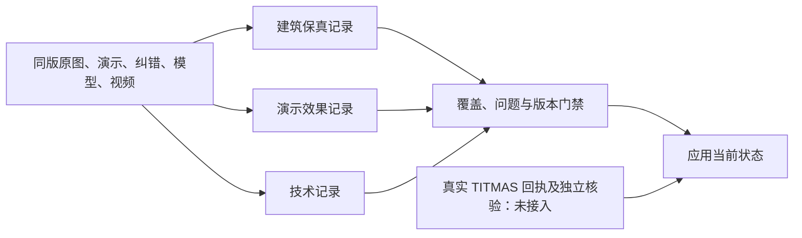

# 本地逐项审查门禁实施记录

日期：2026-09-23。主责任工作区：`/Volumes/ORICO_DATA/Projects/3d盖楼`。用户认可先研后定结论后，本批将有界审查合同落实到应用。TITMAS 核心与 DCell 注册未变动。

## 已落实的行为

原有总体视觉 PASS 现在还必须通过逐项记录校验。鹳雀楼按 20 项合同分成建筑保真 9、演示匹配 5、技术 4、外部 TITMAS 2；18 项本地必审全部有效才能满足内容记录门禁。TITMAS 保留真实连接与独立核验要求，本地记录不能代替回执。

合同绑定原图、原演示、用户追加纠错、当前任务/模型/视频、当前工作源码、冻结快照源码、镜头与历史渲染证据。每次重新检查当前字节。遗漏、UNKNOWN、未执行、FAIL、未关闭 P1、施工者自签、缺访问记录、过期输入不能通过。已出片但逐项记录未完成，汇总为 NEEDS_REVISION。

独立复核还发现“换成新视频，保留旧文件和旧审查”的绑定缺口，已增加当前 job 工件强制绑定及视觉项对实际当前视频的覆盖要求。只有把新视频附加到未使用的输入列表也不能通过。原来源记录里的 provenance.evidence、方案/视频的 source_snapshot、视频的 render_evidence 也重新核对哈希。



分工是逻辑职责；可以共用模型、工具和运行环境，不自动创建多个 DCell。协调者没有覆盖失败或授予发布权的能力。

## 验证与范围

本地控制测试 **34/34 通过**（14 项集成、20 项专项）；独立复核发现的 1 个 P1、2 个 P2 均已修复并重验关闭。最终测试及保护文件 readback 见 [validation.json](validation.json) 与 [test-output.txt](test-output.txt)。集成检查保留原 DRAFT/READY_TO_BUILD 行为，并测试通用 PASS、换片冒用、嵌套引用变化等失败情况；模块检查覆盖逐项输入/结果、证据角色、P1 问题、覆盖率和路径边界。合成测试证明控制行为，不证明建筑保真或模型真的看懂图片。

独立审查记录见 [independent-review.json](independent-review.json)。本地门禁只可有条件推荐用于阻断漏项和过期记录。不能将其推荐为自动视觉正确性判断、检查者认证或 TITMAS 线上可用证明。

## 当前实物状态

- 原模型、原视频和历史倒查保留，本批没有修改模型、重新出片或签发新视觉 PASS。
- 当前 job：NEEDS_REVISION；原 checks.visual：FAIL；新逐项审查：NOT_RUN，18 项本地必审待执行。
- 技术旧 PASS 仅适用于原视频技术记录；TITMAS：NOT_CONNECTED / NOT_RUN；发布：NOT_RUN。
- 输入哈希和访问记录支持追溯；不能证明来源真伪、真实身份或真实模型理解。尚未接入独立认证工具轨迹。
- 新纠错须登记到规范资料和新合同；系统不能自动发现未登记的新对话。不能手改旧摘要冒称重验。

## 下一阶段的比较

已备 [A0/C 公平比较计划](comparison-plan.md)，共同资料、清单、工具、总预算和盲评条件；保留单个多模态审查者基线。计划样本、gold 和实际运行未完成，收益 NOT_MEASURED。数值仅为设计提案，不是费用授权或 SLA。原坏视频只作已曝光回归，不能同时充当盲测与合格正例。

后续应先修建筑/镜头、补充真实正例和所需资料，再进行同版逐项审查及有界比较。只有出现重复可复现的通用合同缺口，才讨论 TITMAS 核心最小扩展。

## 追溯与恢复

[before-manifest.json](before-manifest.json) 保存修改前摘要和受保护文件清单；`before/` 保存原文件。工作区没有 Git，本批未创建提交或 PR。恢复前核对后续修改，再有选择地恢复，避免覆盖其他工作。DBA 只保存用户采纳与本工件引用，未代替应用状态。

机器入口：[review-contract.json](../../jobs/guanque-pilot/review-contract.json)、[REVIEW.md](../../pipeline/REVIEW.md)。

## TITMAS_DRIFT_CHECK

```text
CORE_INTEROPERABILITY_OBJECTIVE_PRESERVED=true
NEW_CONTROL_AUTHORITY_CREATED=false
NEW_TRUTH_SOURCE_CREATED=false
DUPLICATE_EVIDENCE_OR_VERIFICATION_CREATED=false
RUNTIME_OR_EXECUTOR_CREATED=false
CURRENT_CAPABILITY_OVERCLAIMED=false
PUBLIC_LAUNCH_AUTHORIZED=false
COMMUNITY_ESTABLISHED=false
RESULT=PASS_WITH_RECORDED_LIMITATIONS
```

上述检查限 TITMAS/DBA 架构边界；本批新增的是应用内部记录校验，没有创设跨项目权力或 TITMAS Runtime。
