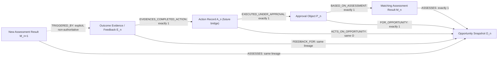

# TITMAS Scout Object Relationship Model v0.1 (Draft)

## Purpose

Define the proposed reference graph and lifecycle dependencies among the four
currently designed TITMAS Scout object families:

- Opportunity Object snapshots;
- applied Matching Assessment Results;
- Approval Objects;
- Feedback and outcome-evidence records.

The required lifecycle also contains an Action Record between Approval and
outcome evidence. No Action Record model currently exists. This document
therefore defines only the minimum relationship contract needed to state that
an Action cannot exist without a valid Approval and that outcome evidence
cannot exist without a completed Action. It does not claim a fifth implemented
object model.

This draft does not modify or extend the field contracts in the
[Opportunity Object](opportunity-object-schema-v0.1.md),
[Matching Score Model](matching-score-v0.1.md),
[Approval Object Model](approval-object-model-v0.1.md), or
[Evidence Feedback Loop](06_evidence_feedback_loop.md). It defines how future
immutable instances would have to reference one another.

## Scope and Object Names

| Graph node | Exact object type | Existing status | Relationship meaning |
| --- | --- | --- | --- |
| Opportunity snapshot | `TITMAS_SCOUT_OPPORTUNITY` | Draft field contract | Root source and problem snapshot |
| Matching assessment | `TITMAS_SCOUT_MATCHING_ASSESSMENT` | Draft result contract only | Attributable application of one matching model to one opportunity snapshot |
| Approval | `TITMAS_SCOUT_APPROVAL` | Draft object grammar | Policy-selected typed reviewer decision bound to one opportunity, assessment, policy, and action request |
| Action | `TITMAS_SCOUT_ACTION` | No model or schema | Future bridge record for one approval-bound execution attempt |
| Outcome evidence | `TITMAS_SCOUT_OUTCOME_EVIDENCE` | Feedback scaffold only | Post-action observation linked to one completed Action |

A Matching Assessment Result is not the Matching Score Model document and is
not an `UNVERIFIED` model-path attachment. It exists only when an attributable
process has used `reference_status: APPLIED` and emitted the result contract.

The word **evidence** has two distinct namespaces:

- **discovery evidence** is source or claim evidence linked from an Opportunity
  Object before any action;
- **outcome evidence** is an Evidence Feedback record produced only after a
  completed Action.

The rule "Evidence must reference completed Action" applies absolutely to
outcome evidence governed by this relationship model. It does not reclassify
the discovery evidence already required by the Opportunity Object.

## Object Graph

All solid arrows below point from the referencing child to its required parent.
The dashed edge represents a possible request for a new assessment, never an
automatic update or authorization.



The permitted forward lifecycle is:

```text
Opportunity snapshot
  -> applied Matching Assessment Result
  -> explicit Approval Object
  -> approval-bound Action Record
  -> completed Action receipt
  -> outcome Evidence Feedback record
  -> optional request for a new assessment generation
```

The graph is append-only. The final edge creates a new assessment object or
request; it never points backward to mutate the earlier assessment, Approval,
Action, evidence, or Opportunity snapshot.

### Relationship Cardinality

| Relationship type | Source | Required target | Cardinality and condition |
| --- | --- | --- | --- |
| `ASSESSES` | Matching assessment | Opportunity snapshot | Exactly one exact snapshot per assessment |
| `FOR_OPPORTUNITY` | Approval | Opportunity snapshot | Exactly one; absence makes the Approval invalid |
| `BASED_ON_ASSESSMENT` | Approval | Matching assessment | Exactly one; assessment MUST bind the same opportunity snapshot |
| `ACTS_ON_OPPORTUNITY` | Action | Opportunity snapshot | Exactly one; MUST equal the Approval's opportunity snapshot |
| `EXECUTED_UNDER_APPROVAL` | Action | Approval | Exactly one effective Approval; multiple Approvals cannot be composed |
| `EVIDENCES_COMPLETED_ACTION` | Outcome evidence | Action | Exactly one primary Action in `COMPLETED` state |
| `FEEDBACK_FOR` | Outcome evidence | Opportunity snapshot | Exactly one lineage root matching the Action and Approval chain |
| `TRIGGERED_BY` | New matching assessment | Outcome evidence | Zero or one primary trigger; it grants no approval or update authority |
| `SUPERSEDES` | New Approval | Prior Approval | Zero or one predecessor under the Approval Model's single-head rules |

One Opportunity may have multiple assessment generations, Approval decisions,
Actions within explicit use limits, and outcome-evidence records. Those
one-to-many relationships never allow permission to be unioned across parent
objects.

## Reference Identifiers

Every authoritative edge MUST use the bound-reference grammar already defined
by the Approval Object Model:

```yaml
reference_id: <non-empty-stable-identifier>
reference_type: <registered-exact-object-type>
reference_uri: <exact-path-or-uri>
version: <immutable-version>
content_digest: sha256:<64-lowercase-hex-characters>
```

All five values participate in identity. `reference_id` alone does not identify
an immutable snapshot. A consumer MUST NOT resolve `latest`, a branch name, a
mutable tag, a fuzzy match, a natural-language label, or a version range as an
authoritative relationship.

The closed object-type vocabulary in v0.1 is:

```text
TITMAS_SCOUT_OPPORTUNITY
TITMAS_SCOUT_MATCHING_ASSESSMENT
TITMAS_SCOUT_APPROVAL
TITMAS_SCOUT_ACTION
TITMAS_SCOUT_OUTCOME_EVIDENCE
```

### Relationship Edge Grammar

A future relationship registry would need an immutable edge record with this
minimum structure:

```yaml
relationship_id: <globally-unique-immutable-identifier>
relationship_type: <closed-v0.1-relationship-enum>
source_reference: <bound-reference>
target_reference: <bound-reference>
lineage_root_reference: <bound-opportunity-reference>
generation: <non-negative-integer>
created_at: <utc-rfc3339-seconds>
reason_codes: []
```

The closed relationship-type vocabulary is:

```text
ASSESSES
FOR_OPPORTUNITY
BASED_ON_ASSESSMENT
ACTS_ON_OPPORTUNITY
EXECUTED_UNDER_APPROVAL
EVIDENCES_COMPLETED_ACTION
FEEDBACK_FOR
TRIGGERED_BY
SUPERSEDES
```

The edge direction is part of its meaning. A consumer MUST NOT infer an inverse
edge, a transitive permission, or a missing intermediate object merely because
two identifiers appear in the same record.

`lineage_root_reference` binds every descendant to the exact Opportunity
snapshot at the root of that generation. A feedback-triggered assessment MUST
also preserve its predecessor assessment reference and primary trigger
evidence reference in its relationship records. A changed Opportunity snapshot
starts a new bound generation; it does not rewrite the prior root.

## Minimum Action Record Relationship Contract

Because the current repository has no Action Object model, this draft defines
only the fields needed to evaluate relationships:

```yaml
object_type: TITMAS_SCOUT_ACTION
action_id: <globally-unique-immutable-identifier>
opportunity_reference: <bound-reference>
approval_reference: <bound-reference>
action_request_reference: <bound-reference>
executor_reference: <bound-reference>
lifecycle_state: AUTHORIZED | RUNNING | COMPLETED
outcome: null | SUCCEEDED | FAILED | PARTIAL | CANCELLED
authorized_at: <utc-rfc3339-seconds>
started_at: <utc-rfc3339-seconds-or-null>
completed_at: <utc-rfc3339-seconds-or-null>
completion_receipt_reference: <bound-reference-or-null>
reason_codes: []
```

A conforming Action Record may be created in `AUTHORIZED` state only after a
future verifier has established one effective `APPROVED` object for the exact
Opportunity, action request, subject, target, environment, parameters, policy,
and time. A rejected or unauthorized request may be retained as an Action
Request or Denial Event, but it MUST NOT be represented as an Action Record.

`COMPLETED` means that the execution attempt is terminal and no further side
effect may occur under the same `action_id`. It requires:

- non-null `started_at` and `completed_at` values in valid temporal order;
- one terminal `outcome` value;
- a bound completion receipt identifying the executor, Action, Approval,
  request digest, timestamps, and observed terminal outcome;
- successful verification of the receipt digest and relationship bindings.

`COMPLETED` does not mean successful. `FAILED`, `PARTIAL`, and `CANCELLED`
attempts are completed attempts and may have outcome evidence. Neither the
Action status nor the receipt proves ground truth, commercial value, safety,
or policy compliance.

The complete Action schema, executor attestation format, receipt signature
profile, and runtime state machine are not defined or implemented here.

## Lifecycle Dependency

### 1. Opportunity to Matching Assessment

A Matching Assessment Result MUST reference exactly one resolvable Opportunity
snapshot. Its opportunity ID, version, and content digest MUST match the root
relationship reference.

An `UNVERIFIED` model reference is not a Matching Assessment Result. An applied
result may validly report `NOT_COMPUTABLE`, `BLOCKED`, or
`COMPUTED_UNCALIBRATED`, but those result states have different downstream
effects.

### 2. Matching Assessment to Approval

Every Approval MUST reference exactly one Opportunity snapshot and exactly one
Matching Assessment Result bound to that same snapshot. An Approval without a
resolvable Opportunity is structurally invalid, regardless of its declared
decision.

For an Approval with declared decision `APPROVED`, the assessment MUST be
`APPLIED`, complete, free of verified hard blockers, and neither
`NOT_COMPUTABLE` nor `BLOCKED`. Under Matching Score v0.1, this leaves
`COMPUTED_UNCALIBRATED` as the only structurally admissible assessment result.
Its numeric value remains diagnostic and never grants approval.

A `NOT_COMPUTABLE` or `BLOCKED` assessment may be retained as the stated basis
for a `DEFERRED` or `REJECTED` decision. It cannot support an effective
`APPROVED` relationship.

### 3. Approval to Action

An Action cannot exist without one valid Approval. Before an Action Record is
created, the future relationship and authorization evaluators MUST establish:

- one resolvable, unsuperseded Approval Object;
- effective state `APPROVED` at the authorization time;
- the same exact Opportunity snapshot and action request;
- complete reviewer, evidence, policy, scope, constraint, and executor gates;
- no conflicting Approval head and no permission composition;
- available atomic usage-limit and replay checks.

If any condition is missing, unknown, unverifiable, expired, superseded, or
conflicting, no Action Record may be created. The result is a denial event, not
an Action.

Approval validity MUST be checked immediately before Action creation, start,
retry, and every externally effective step. If an Approval expires or is
superseded while an Action is running, the existing Action remains as an audit
record, but no new material effect is permitted. The executor must stop at a
safe boundary and may close the attempt as `COMPLETED` with outcome `PARTIAL`
or `CANCELLED` and an attributable reason code.

### 4. Completed Action to Outcome Evidence

Every Outcome Evidence Feedback record MUST reference exactly one completed
Action and the exact completion receipt digest. It MUST also resolve the same
Opportunity lineage and Approval through that Action.

An Outcome Evidence record is invalid when the Action is `AUTHORIZED` or
`RUNNING`, the completion receipt is missing or unverifiable, the Action and
receipt digests disagree, or the lineage cannot be traversed to one exact
Opportunity snapshot.

The minimum relationship-bearing feedback fields are:

```yaml
feedback_id: <globally-unique-immutable-identifier>
action_reference: <bound-completed-action-reference>
completion_receipt_reference: <same-bound-receipt-reference>
opportunity_reference: <same-lineage-root-reference>
observed_at: <utc-rfc3339-seconds>
source_evidence_ref: <bound-reference>
ground_truth_source: <bound-reference-or-null>
subject_refs:
  - <bound-reference>
```

The receipt is execution evidence, not ground truth. If an attributable source
or applicable ground-truth policy is missing, the feedback remains
`INSUFFICIENT_EVIDENCE` and cannot update a score, Approval, policy, or object.

### 5. Outcome Evidence to Revalidation

Outcome evidence may request a new assessment generation only through an
explicit `TRIGGERED_BY` relationship. It MUST NOT update an earlier assessment
in place and MUST NOT create, renew, supersede, or expand an Approval.

A feedback-triggered assessment preserves:

- the exact Opportunity lineage root;
- a new assessment identifier and immutable version;
- a generation value greater than its predecessor;
- the predecessor assessment reference when one exists;
- the primary trigger evidence reference;
- all additional evidence as separately bound supporting references.

Concurrent feedback records are all retained. They may create separate
revalidation candidates, but they MUST NOT be silently discarded, merged, or
selected as a new current assessment. If competing assessment heads remain
unresolved, no new Approval may become effective.

### Snapshot and Version Semantics

A later Opportunity or assessment version does not mutate an earlier Approval
or change its declared decision. The Approval remains bound only to the exact
snapshots and request it originally referenced. It cannot authorize an Action
against the later version.

A new snapshot, request, scope, evidence basis, or assessment requires a new
Approval Object and, when applicable, an explicit `SUPERSEDES` relationship.
Expiration or failure of that successor never reactivates the predecessor.

## Temporal Constraints

Every relied-on timestamp uses RFC 3339 UTC seconds. The trusted ordering for a
single forward lifecycle is:

```text
opportunity snapshot finalized
  <= assessment recorded
  <= approval decided and recorded
  <= action authorized
  <= action started
  <= action completed
  <= outcome evidence recorded
```

An outcome may be observed at or after Action completion. A later observation
does not extend the Approval validity window. If the evaluator cannot establish
a trusted time, ordering, or finalized parent snapshot, the downstream
relationship is invalid for action or feedback processing.

References to a future, mutable, incomplete, or not-yet-finalized parent are
not valid forward relationships.

## Invalid States

| Reason code | Invalid condition | Required effect |
| --- | --- | --- |
| `UNKNOWN_RELATIONSHIP_TYPE` | Edge type is absent or outside the closed enum | Relationship `INVALID`; no traversal or permission |
| `REFERENCE_UNRESOLVED` | A required target cannot be resolved exactly | Descendant invalid for downstream use |
| `REFERENCE_TYPE_MISMATCH` | Resolved object type differs from `reference_type` | Relationship `INVALID` |
| `REFERENCE_VERSION_AMBIGUOUS` | Reference uses `latest`, range, mutable tag, or no immutable version | Relationship `INVALID` |
| `REFERENCE_DIGEST_MISMATCH` | Resolved bytes do not match `content_digest` | Relationship `INVALID` |
| `MODEL_REFERENCE_NOT_ASSESSMENT` | An `UNVERIFIED` model path is used as a result object | Approval basis invalid |
| `OPPORTUNITY_ASSESSMENT_MISMATCH` | Assessment and Approval bind different Opportunity snapshots | Approval invalid |
| `APPROVAL_WITHOUT_OPPORTUNITY` | Approval has no resolvable exact Opportunity parent | Approval does not exist as a conforming object |
| `ASSESSMENT_NOT_ADMISSIBLE` | `APPROVED` uses `NOT_COMPUTABLE`, `BLOCKED`, incomplete, or unapplied assessment | Authorization `DENY` |
| `ACTION_WITHOUT_VALID_APPROVAL` | Action lacks one effective, applicable Approval | No conforming Action Record may be created |
| `ACTION_APPROVAL_MISMATCH` | Action request, scope, or Opportunity differs from Approval | Action creation or effect `DENY` |
| `ACTION_APPROVAL_SUPERSEDED` | Action is created or continues an effect under a superseded Approval | Action `DENY` or stop before the effect |
| `EVIDENCE_WITHOUT_COMPLETED_ACTION` | Outcome evidence references no Action or a non-completed Action | Evidence relationship `INVALID` |
| `COMPLETION_RECEIPT_MISMATCH` | Action, executor, request, outcome, or receipt digest disagrees | Evidence relationship `INVALID` |
| `LINEAGE_MISMATCH` | Descendant crosses Opportunity roots or generations without an explicit new root | Relationship `INVALID` |
| `TEMPORAL_ORDER_INVALID` | Child precedes or references an unfinished required parent | Relationship `INVALID` |
| `RELATIONSHIP_CYCLE` | An edge points to itself, an ancestor points to a descendant, or a cycle is detected | Entire affected subgraph invalid for downstream action |
| `CONFLICTING_RELATIONSHIP_HEADS` | Multiple applicable Approval or assessment heads cannot be ordered | Authorization and automatic revalidation `DENY` |
| `PERMISSION_COMPOSITION_DETECTED` | Partial authority is joined across Approvals, policies, or lineages | Authorization `DENY` |
| `FEEDBACK_MUTATES_HISTORY` | Feedback overwrites a source, object, assessment, policy, Approval, Action, or evidence record | Update rejected; original records retained |

An invalid descendant MUST NOT cause a parent audit record to be erased or
rewritten. Existing Action records remain attributable historical records even
when later validation finds a relationship defect; the defect blocks new
effects and is appended as evidence or a reason-coded finding.

### State Compatibility Matrix

| Parent or object state | Permitted downstream use |
| --- | --- |
| Assessment `NOT_COMPUTABLE` | May support `DEFERRED` or `REJECTED`; never effective `APPROVED` |
| Assessment `BLOCKED` | May support `REJECTED` or `DEFERRED`; never effective `APPROVED` |
| Assessment `COMPUTED_UNCALIBRATED` | May be reviewed as an Approval basis; score itself grants nothing |
| Approval `REJECTED`, `DEFERRED`, or `EXPIRED` | No Action Record |
| Approval effective `APPROVED` | Action candidate only after every independent gate passes |
| Action `AUTHORIZED` or `RUNNING` | No Outcome Evidence parent relationship |
| Action `COMPLETED` with verifiable receipt | May be referenced by Outcome Evidence |
| Outcome `SUCCEEDED`, `FAILED`, `PARTIAL`, or `CANCELLED` | May be recorded; no automatic positive, negative, or ground-truth interpretation |

## Fail-Closed Rules

The following rules are mandatory for any future consumer:

- **Approval cannot exist without Opportunity.** Every Approval MUST bind one
  exact, resolvable Opportunity snapshot. Missing, ambiguous, or mismatched
  lineage makes the Approval invalid.
- **Action cannot exist without valid Approval.** A conforming Action Record is
  created only after one exact Approval is effective and all independent gates
  pass. An Action Request or denial record is not an Action.
- **Evidence must reference completed Action.** Every Outcome Evidence Feedback
  record binds one `COMPLETED` Action and its exact completion receipt. A
  pending, running, unresolved, or receipt-less Action cannot be its parent.
- **Unknown relationship defaults to invalid.** Unknown type, direction,
  cardinality, version, digest, lineage, state, or temporal semantics produce
  `INVALID` and no permission.
- **A relationship is not authority.** A graph edge proves only an asserted,
  verifiable linkage. It does not approve, execute, validate truth, or satisfy
  policy.
- **No skipped dependency.** Assessment, Approval, Action, and outcome evidence
  cannot infer or synthesize a missing parent.
- **No cross-object permission composition.** Authority from different
  Approvals, policies, requests, Opportunity roots, or generations cannot be
  unioned.
- **No mutable reference resolution.** `latest`, fallback versions, implicit
  aliases, and nearest-match lookup never repair a broken edge.
- **No retroactive validation.** Outcome evidence cannot make an earlier
  Opportunity, assessment, Approval, or Action valid after the fact.
- **No automatic feedback authority.** Feedback may request revalidation only;
  it cannot change a score, create an Approval, or trigger an Action.
- **No historical mutation.** Corrections and revalidation create new linked
  objects and preserve all prior facts, decisions, outcomes, and reason codes.
- **Deny propagates forward, not destructively backward.** An invalid parent or
  edge blocks downstream creation or effect but never deletes the audit trail.

## Agent-Readable Requirements

Any future schema, registry, validator, or consumer MUST preserve:

- exact, case-sensitive object and relationship enums;
- one documented direction and cardinality for every relationship type;
- immutable references containing ID, type, URI, version, and SHA-256 digest;
- explicit Opportunity lineage root and assessment generation;
- separate values for object state, relationship validity, authorization
  result, execution lifecycle, terminal outcome, and evidence status;
- reason codes and exact failing object or field paths for every invalid edge;
- discovery-evidence and outcome-evidence namespaces without aliasing;
- a closed relationship vocabulary in which unknown values are invalid;
- no natural-language field, inferred inverse, traversal shortcut, or graph
  proximity as permission;
- deterministic denial when references conflict or cannot be verified.

A future validator starts from `INVALID` and may emit `VALID` only after every
required node and edge verifies:

```text
relationship_status=INVALID

require known_relationship_type_and_direction
require exact_source_and_target_types
require resolvable_immutable_versions
require matching_content_digests
require valid_cardinality
require one_opportunity_lineage
require acyclic_forward_generation
require compatible_parent_and_child_states
require trusted_temporal_order

relationship_status=VALID
```

`VALID` relationship status still does not imply `APPROVED`, `ALLOW`,
`COMPLETED`, ground truth, or successful feedback processing.

## Adversarial Conformance Cases

| Case | Required result |
| --- | --- |
| Approval references an assessment but no Opportunity | `APPROVAL_WITHOUT_OPPORTUNITY`; invalid |
| Approval and assessment use different Opportunity digests | `OPPORTUNITY_ASSESSMENT_MISMATCH`; invalid |
| High score is linked directly to an Action | Missing valid Approval; no Action Record |
| Action combines target scope from two Approvals | `PERMISSION_COMPOSITION_DETECTED`; `DENY` |
| Approval is superseded before Action creation | `ACTION_APPROVAL_SUPERSEDED`; no Action Record |
| Approval expires while Action is running | Stop before next material effect; retain and close Action record |
| Evidence references a `RUNNING` Action | `EVIDENCE_WITHOUT_COMPLETED_ACTION`; invalid |
| Failed Action has a terminal, verified receipt | It may have outcome evidence with `outcome: FAILED` |
| Evidence receipt digest differs from the Action receipt | `COMPLETION_RECEIPT_MISMATCH`; invalid |
| Feedback points to a prior assessment as an update target | `FEEDBACK_MUTATES_HISTORY`; reject update |
| Two concurrent feedback records arrive | Retain both; no automatic merge, winner, score update, or Approval |
| A newer assessment exists after Approval | Old Approval remains bound only to its old snapshots; no cross-version reuse |
| Relationship type is unfamiliar but names known objects | `UNKNOWN_RELATIONSHIP_TYPE`; invalid |
| Resolver falls back from a missing version to `latest` | `REFERENCE_VERSION_AMBIGUOUS`; invalid |

## Non-Implications

This model does not imply:

- formal schemas for relationship, Action, or feedback records;
- that an Opportunity, assessment, Approval, Action, receipt, or evidence item
  is valid merely because it appears in the graph;
- automatic graph traversal, revalidation, scoring, approval, execution, or
  model updates;
- implemented identity, authority, policy, digest, time, signature, or
  ground-truth verification;
- that a completed Action succeeded or that its outcome is ground truth;
- production safety, deployment readiness, legal effect, or commercial
  validation.

## Current Unimplemented Capabilities

- formal JSON Schema or YAML schema for relationship edges;
- object-type and relationship-type registries;
- bound-reference resolver, canonical serialization, and digest verification;
- graph storage, indexing, traversal, lineage, and generation management;
- relationship cardinality, cycle, branch, and conflict validation;
- Matching Assessment Result instance schema and evaluator;
- complete Action Record schema and lifecycle engine;
- safe-output Action Request and Denial Event schemas;
- Approval validity, identity, authority, policy, trusted-time, and
  attestation verification;
- permissioned executor, atomic usage ledger, replay protection, stop, and
  rollback controls;
- completion receipt format, executor signature, and receipt verifier;
- Outcome Evidence schema, ground-truth policy, drift policy, and feedback
  processor;
- concurrent feedback reconciliation and revalidation scheduler;
- conformance tests, security review, and production validation.

## Truth Boundary

```text
OBJECT_RELATIONSHIP_MODEL_DEFINED=true
OBJECT_RELATIONSHIP_SCHEMA_DEFINED=false
OBJECT_RELATIONSHIP_VALIDATOR_IMPLEMENTED=false
OBJECT_RELATIONSHIP_REGISTRY_IMPLEMENTED=false
ACTION_RECORD_MINIMUM_RELATIONSHIP_CONTRACT_DOCUMENTED=true
ACTION_RECORD_SCHEMA_DEFINED=false
ACTION_LIFECYCLE_ENGINE_IMPLEMENTED=false
OUTCOME_EVIDENCE_SCHEMA_DEFINED=false
FEEDBACK_PROCESSOR_IMPLEMENTED=false
RELATIONSHIP_MODEL_VALIDATED=false
ACTION_AUTHORITY_GRANTED=false
EXTERNAL_ACTION_AUTHORIZED=false
```
