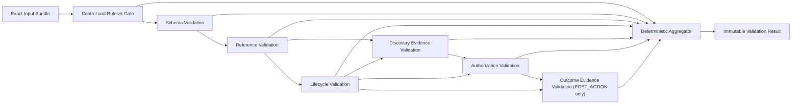

# TITMAS Scout Validation Model v0.1 (Draft)

## Purpose

Define a deterministic, agent-readable proposal for validating the trust chain
across exact Opportunity, Matching Assessment, Approval, Action, and outcome
Evidence snapshots.

The model specifies validation architecture, rule categories, stable rule
identifiers, severity levels, result aggregation, and failure behavior. It does
not implement a validator, establish that any current object is valid, create
an Approval, grant authorization, or permit execution.

The current source documents are draft field contracts and model proposals,
not formal executable schemas. Therefore this document defines how a future
validator must fail closed when a required schema, resolver, verifier, policy,
trusted time source, or runtime dependency is unavailable. It does not label
the current object chain `VALID` merely because the proposed rules are written
down.

## Source Contracts

The proposed rule set consumes exact, immutable snapshots governed by:

- [Opportunity Object Schema v0.1](opportunity-object-schema-v0.1.md);
- [Matching Score Model v0.1](matching-score-v0.1.md);
- [Approval Object Model v0.1](approval-object-model-v0.1.md);
- [Agent Review Quorum v0.1](agent-review-quorum-v0.1.md);
- [Object Relationship Model v0.1](object-relationship-model-v0.1.md).

Validation MUST preserve the truth boundaries in those documents. This model
does not add fields to them, reinterpret their statuses, or turn their draft
contracts into formal schemas.

## Normative Vocabulary

The keywords `MUST`, `MUST NOT`, `REQUIRED`, and `MAY` describe the proposed
future contract. This artifact is non-normative and non-executable; the terms
do not assert that an implementation exists.

Definitions:

- **input bundle**: the exact object, relationship, policy, evidence, schema,
  and trust-reference snapshots evaluated in one run;
- **ruleset manifest**: the exact ordered set of rule definitions required by
  one validation profile;
- **validation profile**: a closed declaration of the chain phase and the rule
  manifest that applies to it;
- **rule dependency**: another rule whose `PASS` result is required before the
  dependent rule may be evaluated;
- **validation failure**: `FAIL`, `BLOCKED_BY_DEPENDENCY`, missing required
  result, unknown result, or invalid `NOT_APPLICABLE` evidence;
- **validation result**: an immutable, evidence-linked record of one attempted
  ruleset application;
- **action gate**: the boundary that remains closed whenever validation is not
  exactly `VALID` and that still requires separate authorization after a valid
  result.

`VALID` means only that all rules required by one exact profile passed for one
exact input bundle at one declared evaluation context. It does not mean
`APPROVED`, `ALLOW`, `AUTHORIZED`, `COMPLETED`, or ground truth.

## Validation Architecture

### Architectural Planes

The proposed validator has three logical planes:

1. **Rule control plane** pins the model, profile, rule definitions,
   dependencies, severities, applicability predicates, and manifest digest.
2. **Validation execution plane** evaluates object and chain rules as an
   acyclic dependency graph.
3. **Audit plane** emits one immutable Validation Result containing every
   expected rule outcome, missing dependency, failure, and non-authorization
   assertion.

The planes are design boundaries, not implemented services.

### Validation Dependency Graph

Validation is a directed acyclic graph rather than one unconditional linear
pipeline. This avoids treating post-action evidence as a prerequisite for the
Approval that had to exist before the Action.



The action gate closes immediately when any required node fails. Independent
rules MAY continue only to collect diagnostics. A rule whose prerequisite did
not pass MUST return `BLOCKED_BY_DEPENDENCY`; it MUST NOT be evaluated against
assumed, repaired, or defaulted input.

### Validation Profiles

The profile is explicit and MUST NOT be inferred from whichever objects happen
to be present.

| Profile | Required scope | Outcome-evidence rules | Result meaning |
| --- | --- | --- | --- |
| `PRE_ACTION_CHAIN` | Opportunity, applied assessment, Approval, action request, policy, discovery evidence, and trust inputs | Excluded by the profile manifest | The proposed pre-action chain passed validation only; no authorization is created |
| `POST_ACTION_CHAIN` | The full pre-action chain plus Action, completion receipt, and outcome evidence | Required | The historical authorization chain and post-action evidence relationships passed validation only |

Rules excluded by a profile are absent from that profile's ruleset manifest;
they are not emitted as `NOT_APPLICABLE`. A required rule may use
`NOT_APPLICABLE` only when its immutable rule definition contains an explicit
applicability predicate and the result includes evidence proving the predicate
false.

Unknown profiles, inferred profiles, profile drift, or a mismatch between the
profile and rule manifest produce `INVALID`.

### Stage Semantics

- Schema Validation establishes whether every included object can be parsed
  against an exact formal schema and satisfies local field invariants.
- Reference Validation establishes exact identity, resolution, type, version,
  digest, direction, cardinality, and lineage bindings.
- Lifecycle Validation establishes structural state compatibility, append-only
  transitions, supersession, generation, and trusted temporal order. A
  lifecycle `PASS` alone does not assert that a transition was authorized.
- Discovery Evidence Validation establishes attributable input evidence before
  Authorization Validation.
- Authorization Validation checks evidence for one existing Approval and its
  gates. It does not issue an Approval or return `ALLOW`.
- Outcome Evidence Validation runs only in `POST_ACTION_CHAIN`, after the
  historical authorization and completed Action chain have been checked.
- The aggregator verifies rule coverage and computes one fail-closed status. It
  cannot change rule results or downgrade severities.

## Validation Status Grammar

### Rule Outcomes

Every expected rule emits exactly one of these outcomes:

| Outcome | Meaning | Aggregation effect |
| --- | --- | --- |
| `PASS` | The exact rule assertion was evaluated and satisfied | May contribute to `VALID` |
| `FAIL` | The assertion was evaluated and not satisfied, or the evaluator errored | Overall `INVALID` |
| `BLOCKED_BY_DEPENDENCY` | A declared prerequisite did not pass or a verifier dependency is unavailable | Overall `INVALID` |
| `NOT_APPLICABLE` | A registered applicability predicate was proven false with evidence | Neutral only when the proof and rule definition verify |

`UNKNOWN`, `SKIPPED`, `UNAVAILABLE`, an empty result, an unrecognized outcome,
or a timeout MUST NOT be treated as neutral. They map to a reason-coded `FAIL`
or `BLOCKED_BY_DEPENDENCY`, and the overall result is `INVALID`.

### Overall Status

The overall status enum is closed:

```text
VALID
INVALID
```

There is no `PARTIALLY_VALID`, `VALID_WITH_WARNINGS`, `ASSUMED_VALID`, or
`UNKNOWN` overall state in v0.1.

The aggregator begins with `INVALID` and emits `VALID` only when:

- the model, profile, ruleset, manifest, and validator trust references verify;
- every expected rule ID appears exactly once;
- no unknown, duplicate, or out-of-profile rule result appears;
- every expected rule is `PASS` or has a valid, evidence-backed
  `NOT_APPLICABLE` result;
- no rule is `FAIL` or `BLOCKED_BY_DEPENDENCY`;
- the input bundle, time context, and result integrity references verify.

Any unmet condition preserves `INVALID`.

Fail-closed aggregation is non-compensatory: no number of `PASS` results can
cancel one validation failure, and evaluation order cannot change the final
status.

## Rule Categories

The v0.1 rule categories are closed and case-sensitive:

| Code | Category | Primary question |
| --- | --- | --- |
| `CTL` | Validation Control | Is the validation attempt itself bound, complete, and trustworthy enough to evaluate? |
| `SCH` | Schema Validation | Does each object conform to an exact available schema and local invariants? |
| `REF` | Reference Validation | Do all bound references resolve to the exact typed, versioned, digested snapshots? |
| `LIF` | Lifecycle Validation | Are states, transitions, generations, supersession, and time order valid? |
| `EVD` | Evidence Validation | Is discovery or outcome evidence attributable, intact, admissible, and correctly linked? |
| `AUT` | Authorization Validation | Does one existing Approval satisfy every independent gate for the exact request? |

Unknown categories are invalid. Category membership does not set evaluation
order; declared rule dependencies do.

## Rule Identifiers

### Identifier Format

Every rule ID has this grammar:

```text
TVM-<CATEGORY>-<THREE-DIGIT-SEQUENCE>
```

Examples are `TVM-SCH-001`, `TVM-REF-004`, and `TVM-AUT-008`.

An ID has one immutable meaning within
`TITMAS-SCOUT-VALIDATION-V0.1`. A changed assertion, scope, dependency,
severity, or failure meaning requires a new rule ID or a new ruleset version.
An ID MUST NOT be reused with changed semantics.

### Rule Definition Contract

Each future registered rule requires:

```yaml
rule_id: TVM-<CATEGORY>-<NNN>
ruleset_id: TITMAS-SCOUT-VALIDATION-V0.1
category: CTL | SCH | REF | LIF | EVD | AUT
severity: CRITICAL | HIGH | MEDIUM | LOW
profiles:
  - PRE_ACTION_CHAIN | POST_ACTION_CHAIN
target_types: []
dependencies: []
applicability_predicate: <closed-structured-expression>
assertion: <bounded-machine-readable-assertion>
failure_reason_code: <registered-reason-code>
definition_digest: sha256:<digest>
```

Free-text rationale may explain a rule but cannot alter its assertion,
applicability, dependencies, severity, or aggregation effect.

### Rule Result Contract

Every expected rule result requires:

```yaml
rule_id: <registered-rule-id>
rule_definition_digest: sha256:<same-definition-digest>
outcome: PASS | FAIL | BLOCKED_BY_DEPENDENCY | NOT_APPLICABLE
severity: CRITICAL | HIGH | MEDIUM | LOW
target_references: []
field_paths: []
evidence_references: []
reason_codes: []
missing_dependencies: []
applicability_evidence: []
evaluated_at: <utc-rfc3339-seconds>
```

A missing rule result, changed definition digest, severity mismatch, duplicate
result, unknown ID, or undeclared dependency produces a `CRITICAL` control
failure and overall `INVALID`.

## Severity Levels

Severity describes blast radius and remediation priority. It never changes
whether a failed rule blocks validation.

| Severity | Intended impact | Required failure effect |
| --- | --- | --- |
| `CRITICAL` | Ruleset, validator, manifest, input-integrity, or aggregation trust cannot be established | Entire run `INVALID`; dependent evaluation stops |
| `HIGH` | Authorization, evidence integrity, reference lineage, or safety-critical chain invariant fails | Affected chain and overall result `INVALID`; action gate closed |
| `MEDIUM` | Object, relationship, lifecycle, or cross-field contract fails | Target and all dependent descendants invalid; overall result `INVALID` |
| `LOW` | A required localized field or metadata invariant fails | Affected object and relying chain invalid; overall result `INVALID` |

There is no warning-and-continue severity in v0.1. A `LOW` failure cannot be
ignored, waived, or converted into a passing result. Severity is fixed in the
rule registry. Runtime severity overrides, UI downgrades, reviewer waivers, and
configuration-based remapping are invalid.

When multiple rules fail, all failures remain in the result. Diagnostic order
is deterministic: `CRITICAL`, `HIGH`, `MEDIUM`, `LOW`, then ascending `rule_id`,
then target reference and field path. Ordering improves triage but never hides
lower-severity failures.

## Validation Result Contract

The following YAML is a structural proposal, not an implemented schema:

```yaml
validation_id: <globally-unique-immutable-identifier>
model_id: TITMAS-SCOUT-VALIDATION-V0.1
model_version: 0.1.0-draft
profile_id: PRE_ACTION_CHAIN | POST_ACTION_CHAIN

ruleset_manifest_reference: <bound-reference>
ruleset_manifest_digest: sha256:<digest>

input_bundle:
  root_opportunity_reference: <bound-reference>
  object_references: []
  relationship_references: []
  policy_references: []
  evidence_references: []
  schema_references: []
  trust_references: []
  bundle_digest: sha256:<digest>

validator:
  identity_reference: <bound-reference>
  implementation_reference: <bound-reference>
  authority_reference: <bound-reference>

time_context:
  evaluated_at: <utc-rfc3339-seconds>
  expires_at: <utc-rfc3339-seconds>
  time_source_reference: <bound-reference>

overall_status: VALID | INVALID
validation_gate: PASSED | FAILED
non_authorization_assertion: VALIDATION_DOES_NOT_GRANT_AUTHORIZATION
authorization_granted: false
external_action_allowed: false
executor_instruction: NONE

rule_results: []
expected_rule_ids: []
missing_rule_ids: []
unknown_rule_ids: []
missing_dependency_manifest: []
failure_summary: []

supersedes_validation_reference: <bound-reference-or-null>
```

The non-authorization fields are invariant in every result, including a
`VALID` result. A consumer that changes, omits, or contradicts them invalidates
the Validation Result.

The result validity window is half-open: `[evaluated_at, expires_at)`. Its
`expires_at` cannot be later than the earliest expiry or required revalidation
boundary among the Approval, policy, evidence freshness, credentials, trust
references, and time-sensitive constraints. If that boundary cannot be
computed or trusted, the result is `INVALID` for downstream action.

Any input digest, rule definition, ruleset manifest, validator trust reference,
or time-sensitive dependency change requires a new Validation Result. An old
`VALID` result does not extend to changed bytes or a later context.

## Rule Catalog

The catalog below defines proposed rule semantics. It is not executable code or
a formal rule registry.

### Validation Control Rules

| Rule ID | Severity | Assertion | Failure behavior |
| --- | --- | --- | --- |
| `TVM-CTL-001` | `CRITICAL` | Model ID, version, and profile are exact and registered | Unknown or drifted identity makes the run `INVALID` |
| `TVM-CTL-002` | `CRITICAL` | Profile ruleset manifest, ordered rule IDs, and manifest digest verify | Missing, extra, duplicate, or changed rules make the run `INVALID` |
| `TVM-CTL-003` | `CRITICAL` | Input bundle is finalized, complete for the profile, and bound by one digest | Mutable, partial, or unbound input makes the run `INVALID` |
| `TVM-CTL-004` | `CRITICAL` | Validator identity, implementation, authority, and integrity references verify independently | Unavailable or self-asserted validator trust blocks evaluation |
| `TVM-CTL-005` | `CRITICAL` | Rule dependency graph is closed, known, and acyclic | Missing dependency or cycle makes the run `INVALID` |
| `TVM-CTL-006` | `CRITICAL` | Every result ID, definition digest, severity, outcome, and profile membership matches the registry | Mismatch, unknown value, or runtime downgrade makes the run `INVALID` |
| `TVM-CTL-007` | `CRITICAL` | Trusted evaluation time and conservative expiry boundary are established | Missing or inconsistent time makes the run `INVALID` |

### Schema Validation

| Rule ID | Severity | Assertion | Failure behavior |
| --- | --- | --- | --- |
| `TVM-SCH-001` | `CRITICAL` | Every included object type has an exact, immutable, resolvable formal schema reference | Missing formal schema returns `BLOCKED_BY_DEPENDENCY`; overall `INVALID` |
| `TVM-SCH-002` | `HIGH` | Serialized input parses under the exact schema and contains all required fields, types, and cardinalities | Parse, field, type, or cardinality error produces `FAIL` |
| `TVM-SCH-003` | `HIGH` | Every enum and status uses a value allowed by the exact schema and model version | Unknown state equals `INVALID`; no default or nearest match |
| `TVM-SCH-004` | `HIGH` | Cross-field invariants for Opportunity, assessment, Approval, Action, and evidence hold | Contradictory fields produce `FAIL` |
| `TVM-SCH-005` | `MEDIUM` | Unknown fields are proven non-authoritative and cannot expand facts, scope, state, or permission | Unproven authoritative effect produces `FAIL` |
| `TVM-SCH-006` | `HIGH` | Object schema versions and model compatibility declarations match exactly | Unsupported or ambiguous version produces `FAIL` |

Because the current repository explicitly has no formal object schemas, a
future execution of `TVM-SCH-001` cannot pass today. The Markdown field
contracts are inputs to future schema design, not substitutes for this rule.

### Reference Validation

| Rule ID | Severity | Assertion | Failure behavior |
| --- | --- | --- | --- |
| `TVM-REF-001` | `HIGH` | Every authoritative reference contains exact ID, type, URI, immutable version, and SHA-256 digest | Missing component produces `FAIL` |
| `TVM-REF-002` | `HIGH` | Each reference resolves to exact bytes whose digest verifies | Resolver unavailable returns `BLOCKED_BY_DEPENDENCY`; mismatch returns `FAIL` |
| `TVM-REF-003` | `HIGH` | Resolved type, version, and URI match the declaration; no `latest`, range, alias, fallback, or fuzzy resolution is used | Ambiguity or fallback produces `FAIL` |
| `TVM-REF-004` | `HIGH` | Assessment, Approval, Action, and evidence resolve to one exact Opportunity lineage | Cross-lineage or cross-snapshot binding produces `FAIL` |
| `TVM-REF-005` | `HIGH` | Relationship direction and cardinality match the closed Relationship Model | Missing, duplicated, inverted, or unknown edge produces `FAIL` |
| `TVM-REF-006` | `HIGH` | The graph has no dangling, self, cyclic, future-parent, or unresolved branching references | Affected graph and overall result become `INVALID` |
| `TVM-REF-007` | `MEDIUM` | Every referenced parent snapshot was finalized before the child bound it | Mutable or unfinished parent produces `FAIL` |

### Lifecycle Validation

| Rule ID | Severity | Assertion | Failure behavior |
| --- | --- | --- | --- |
| `TVM-LIF-001` | `HIGH` | Every object state is explicit and belongs to its model's closed state vocabulary | Unknown state equals `INVALID` |
| `TVM-LIF-002` | `HIGH` | Declared transitions follow the source model and create immutable successor records | Illegal or in-place transition produces `FAIL` |
| `TVM-LIF-003` | `HIGH` | Trusted timestamps satisfy the required forward order and half-open validity intervals | Missing, reversed, or untrusted time produces `FAIL` or dependency block |
| `TVM-LIF-004` | `HIGH` | Matching result state and downstream Approval decision are compatible | `NOT_COMPUTABLE` or `BLOCKED` cannot support effective `APPROVED` |
| `TVM-LIF-005` | `HIGH` | Approval supersession is single-head, acyclic, append-only, and never reactivates a predecessor | Conflict, branch, cycle, or stale fallback produces `FAIL` |
| `TVM-LIF-006` | `HIGH` | Action creation, start, retry, and each material effect are preceded by current Approval checks | Missing, expired, or superseded Approval closes the action gate |
| `TVM-LIF-007` | `HIGH` | `COMPLETED` Action is terminal and has ordered timestamps, one terminal outcome, and a bound receipt | Incomplete terminal state produces `FAIL` |
| `TVM-LIF-008` | `HIGH` | Feedback creates a new generation, preserves concurrent records, and never mutates history | Overwrite, silent merge, or implicit current-head selection produces `FAIL` |

Lifecycle Validation checks structural and temporal conformance. Authorization
rules separately verify that the authority evidence for a transition is valid.
A lifecycle `PASS` cannot compensate for an Authorization failure.

### Evidence Validation

| Rule ID | Severity | Assertion | Failure behavior |
| --- | --- | --- | --- |
| `TVM-EVD-001` | `HIGH` | Evidence namespace is exactly discovery evidence or outcome evidence and is not aliased across them | Missing or ambiguous namespace produces `FAIL` |
| `TVM-EVD-002` | `HIGH` | Evidence source, observer, provenance, immutable reference, and digest verify independently | Missing verifier blocks the rule; mismatch produces `FAIL` |
| `TVM-EVD-003` | `HIGH` | Observation time, assessment time, freshness policy, and rejection boundary are present and satisfied | Missing policy or stale evidence produces `FAIL` |
| `TVM-EVD-004` | `HIGH` | Every relied-on claim has explicit admissible evidence references and no missing fact is inferred | Missing mapping or inferred support produces `FAIL` |
| `TVM-EVD-005` | `HIGH` | Outcome evidence references exactly one `COMPLETED` Action and the exact completion receipt | Running, unresolved, or receipt-less Action produces `FAIL` |
| `TVM-EVD-006` | `CRITICAL` | Receipt digest, executor identity, signature or attestation, source, timestamps, Action, Approval, and request binding verify | Verifier unavailable blocks the rule; integrity failure produces `FAIL` |
| `TVM-EVD-007` | `HIGH` | Receipt is treated as execution evidence, not ground truth; feedback use has an attributable ground-truth source and policy | Missing ground-truth basis blocks any update and makes feedback insufficient |
| `TVM-EVD-008` | `HIGH` | Unknown, rejected, or insufficient feedback is retained with reasons and cannot update prior records | Discard or mutation attempt produces `FAIL` |
| `TVM-EVD-009` | `MEDIUM` | Terminal outcome is preserved as `SUCCEEDED`, `FAILED`, `PARTIAL`, or `CANCELLED` without automatic positive or negative interpretation | Inferred outcome meaning produces `FAIL` |

`TVM-EVD-001` through `TVM-EVD-004` apply to discovery evidence in both
profiles. `TVM-EVD-005` through `TVM-EVD-009` are included only in the
`POST_ACTION_CHAIN` manifest. They are not marked `NOT_APPLICABLE` in
`PRE_ACTION_CHAIN`.

### Authorization Validation

| Rule ID | Severity | Assertion | Failure behavior |
| --- | --- | --- | --- |
| `TVM-AUT-001` | `CRITICAL` | Exactly one immutable Approval exists and its Opportunity, assessment, request, and policy chain already passed prerequisite validation | Missing or conflicting Approval produces `FAIL` |
| `TVM-AUT-002` | `CRITICAL` | Declared decision is `APPROVED`, effective state is `APPROVED`, the validity window is current, and the Approval is the unique unsuperseded head | Any other or unknown state closes the action gate |
| `TVM-AUT-003` | `HIGH` | Assessment is `APPLIED`, complete, free of hard blockers, and not `NOT_COMPUTABLE` or `BLOCKED` | Inadmissible assessment produces `FAIL`; score value grants nothing |
| `TVM-AUT-004` | `CRITICAL` | Reviewer type and its required identity or runtime identifiers, roles, authority scope, credential or digest status, independence evidence, and attestation verify independently | Missing verifier returns dependency block; any mismatch produces `FAIL` |
| `TVM-AUT-005` | `CRITICAL` | Exact Action Policy is resolvable, applicable, independently evaluates to allow the request, and has not expired | Missing engine returns dependency block; denial or expiry produces `FAIL` |
| `TVM-AUT-006` | `CRITICAL` | Exact action request, subject, target, environment, parameters, and digests are inside both the allowlist and authorized scope | Unknown, mismatch, or excess scope produces `FAIL` |
| `TVM-AUT-007` | `CRITICAL` | No blocked action matches and every hard constraint, evidence gate, and executor static permission passes | Any denial, unknown, or unmet constraint produces `FAIL` |
| `TVM-AUT-008` | `CRITICAL` | Atomic attempt and successful-use limits, replay protection, and no-permission-composition invariant can be enforced | Unavailable ledger or conflict returns dependency block; no action |
| `TVM-AUT-009` | `HIGH` | Validation is current at the exact point of proposed effect and all time-sensitive inputs still match | Stale or changed context produces `FAIL` and requires revalidation |
| `TVM-AUT-010` | `CRITICAL` | Result preserves the exact non-authorization assertion and all action-grant fields remain false or none | Missing or contradictory assertion invalidates the result |

Authorization Validation validates evidence about an existing typed reviewer
decision. It never mints an Approval, changes `decision`, returns `ALLOW`,
grants a token, creates an Action, or instructs an executor.

When identity, policy, time, receipt, usage, or other required verification
capability is unavailable, the affected rule result is
`BLOCKED_BY_DEPENDENCY` with a machine-readable missing-dependency entry. The
overall result remains `INVALID` and the action gate remains closed. Dependency
diagnostics never create a third, permissive overall state.

## Failure Behavior

### Immediate Control Effect

On the first validation failure, a future validator MUST immediately set:

```text
overall_status=INVALID
validation_gate=FAILED
non_authorization_assertion=VALIDATION_DOES_NOT_GRANT_AUTHORIZATION
authorization_granted=false
external_action_allowed=false
executor_instruction=NONE
```

Those values cannot be reversed by later rule passes in the same run.

### Failure Preservation

A validation failure cannot be ignored. Specifically:

- no rule failure may be suppressed, acknowledged away, waived, or hidden;
- no severity may be downgraded at runtime;
- no missing rule may be treated as implicitly passed;
- no timeout, exception, unavailable verifier, or unknown state may be treated
  as neutral;
- no high score, reviewer note, relationship edge, prior `VALID` result, or
  Approval label can override a failure;
- no default value or automatic repair may make an invalid input appear valid;
- all independent failures found after the gate closes remain in the result;
- dependent rules record `BLOCKED_BY_DEPENDENCY` and the exact missing rule or
  capability;
- the failed result and its inputs remain immutable audit evidence.

Correction requires a new object snapshot or corrected dependency and a new
Validation Result. The prior failure remains addressable and MUST NOT be
deleted or rewritten.

### Result Supersession and Conflict

A future result may supersede one prior result only through an explicit bound
reference, the same input-bundle lineage, a compatible profile and ruleset, and
verifiable validator authority. Supersession never erases the prior result.

Self-reference, cycles, branches, multiple unsuperseded heads, incompatible
profiles, changed bundles hidden behind the same ID, or resolution through
`latest` produce `INVALID`. Expiration or failure of a successor never
reactivates an older `VALID` result.

### Failure Propagation

Failure propagates forward to every descendant that relies on the invalid
object, edge, evidence item, rule, or trust dependency. It does not
destructively propagate backward: source objects, prior decisions, Action
records, receipts, evidence, and failed results remain in the audit trail.

An existing Action discovered after an Authorization or relationship failure
remains an attributable historical record; validation cannot erase it or make
it retroactively authorized. The failure blocks new material effects and is
recorded separately.

## Unknown State Handling

Unknown state equals `INVALID` throughout v0.1. This includes an unknown:

- model, profile, rule ID, rule definition, category, severity, dependency, or
  outcome;
- object type, schema version, field, enum, lifecycle state, or transition;
- reference type, version, digest, direction, cardinality, lineage, or parent;
- evidence provenance, freshness, admissibility, namespace, or ground-truth
  status;
- Approval decision, effective state, policy result, reviewer authority, time,
  scope, constraint, permission, or usage count;
- validator identity, implementation, authority, integrity, or result head.

An explicit `NOT_APPLICABLE` result is not an unknown state. It is valid only
when the registered predicate, target facts, applicability evidence, and rule
definition digest all verify. Otherwise the rule fails.

## Validation Does Not Create Authorization

Validation is an evidence gate, not an authority source.

The following invariant always holds:

```text
VALID != APPROVED
VALID != ALLOW
VALID != AUTHORIZED
VALID != EXTERNAL_ACTION_ALLOWED
```

A `VALID` pre-action result may be one input to a future independent
authorization and execution boundary. That boundary must still recheck the
current Approval, policy, scope, constraints, time, executor permissions,
usage limits, and exact request immediately before every material effect.

Agent Review Quorum v0.1 is a separate authorization component, not an
extension of this Validator. Its reviewers may consume a Validation Result as
evidence, and its deterministic aggregator may produce internal `ALLOW` only
after all policy-required reviews pass. The Validator's own result must still
preserve `authorization_granted=false` and cannot be reinterpreted as the
quorum decision.

The validator MUST NOT:

- create, sign, renew, supersede, or modify an Approval Object;
- infer authorization from an Opportunity status, matching score, evidence
  volume, relationship validity, or validation success;
- return an executable `ALLOW` decision or capability token;
- create an Action Record or hold execution credentials;
- mutate evidence, policy, scores, lifecycle states, or prior results.

## Agent-Readable Requirements

Any future schema, registry, validator, or consumer MUST preserve:

- exact case-sensitive model, profile, category, rule, severity, outcome,
  reason-code, and object enums;
- immutable rule definitions and manifests bound by SHA-256 digest;
- explicit rule dependencies and a validated acyclic dependency graph;
- exact expected-rule coverage with no implicit pass or profile inference;
- structured applicability predicates and evidence-backed
  `NOT_APPLICABLE` results;
- exact input bundle, target references, field paths, evidence references,
  missing dependencies, and trusted timestamps;
- deterministic aggregation and diagnostic ordering;
- separate object state, rule outcome, validation status, Approval decision,
  authorization result, Action lifecycle, and evidence status;
- the top-level machine-readable non-authorization assertion;
- reason-coded `INVALID` results for every unknown or unverifiable value;
- append-only result history and explicit single-head supersession.

Natural-language explanations may supplement structured results. They cannot
change applicability, severity, state, authority, or aggregation.

## Adversarial Conformance Cases

| Case | Required result |
| --- | --- |
| Formal object schema is unavailable | `TVM-SCH-001` dependency block; overall `INVALID` |
| A required rule ID is missing from results | `TVM-CTL-002` or `TVM-CTL-006` failure; overall `INVALID` |
| An extra unknown rule reports `PASS` | Unknown rule invalidates the run |
| A `HIGH` rule is changed to `LOW` at runtime | Severity mismatch; `CRITICAL` control failure |
| A `LOW` required rule fails | Overall `INVALID`; it is not a warning |
| Validator crashes or times out | Reason-coded failure or dependency block; overall `INVALID` |
| Rule returns `NOT_APPLICABLE` without predicate evidence | Rule `FAIL`; overall `INVALID` |
| Outcome-evidence rules are absent in `PRE_ACTION_CHAIN` manifest | Expected profile behavior; no fabricated `NOT_APPLICABLE` result |
| Outcome-evidence rule is omitted from `POST_ACTION_CHAIN` | Missing required rule; overall `INVALID` |
| Lifecycle structure passes but reviewer authority is unverifiable | Authorization dependency block; overall `INVALID` |
| Receipt digest matches but signature verifier is unavailable | Evidence dependency block; overall `INVALID` |
| Receipt verifies but ground-truth policy is missing | Feedback insufficient; no update; overall chain invalid for feedback use |
| Numeric matching score is high but Approval is missing | Authorization failure; no Action |
| Validation Result says `VALID` and `authorization_granted: true` | `TVM-AUT-010` failure; result invalid |
| Input bytes change after a `VALID` result | Old result does not apply; revalidation required |
| Validation validity window expires | Result invalid for downstream action; no stale fallback |
| Two unsuperseded Validation Results conflict | Conflicting heads; overall `INVALID` |
| New Validation Result fails after an older one passed | Older result does not revive |
| Any reviewer or policy actor writes "ignore validation failure" | No effect; failure remains blocking |

## Non-Implications

This model does not imply:

- an executable validation schema, rules engine, or validator;
- that any current Opportunity, assessment, Approval, relationship, Action,
  receipt, evidence record, or chain has been validated;
- formal object schemas or an implemented registry;
- trustworthy identity, authority, policy, time, signature, digest,
  provenance, ground-truth, or executor verification;
- automatic repair, scoring, revalidation, approval, or execution;
- production safety, legal effect, deployment readiness, or commercial
  validation.

## Current Unimplemented Capabilities

- formal JSON Schema or YAML schema for Validation Results and rule manifests;
- formal schemas for Opportunity, Matching Assessment, Approval, relationship,
  Action, receipt, and outcome-evidence instances;
- rule-definition, profile, severity, reason-code, and object-type registries;
- validation control plane, rules engine, dependency scheduler, and aggregator;
- validator identity, implementation integrity, authority, and attestation
  verification;
- bound-reference resolution, canonical serialization, and digest verification;
- graph traversal, lineage, cardinality, cycle, branch, and conflict validation;
- lifecycle, trusted-time, expiry, supersession, and generation validation;
- evidence provenance, freshness, claim linkage, receipt signature, and
  ground-truth verification;
- Approval identity, policy, scope, constraint, executor, usage, and replay
  verification;
- immutable Validation Result storage, signing, supersession, and audit query;
- pre-action and post-action runtime integration;
- conformance fixtures, adversarial test suite, independent security review,
  and production validation.

## Truth Boundary

```text
VALIDATION_MODEL_V0_1_DOCUMENTED=true
VALIDATION_RULE_CATALOG_DOCUMENTED=true
VALIDATION_MODEL_SCHEMA_DEFINED=false
FORMAL_OBJECT_SCHEMAS_AVAILABLE=false
VALIDATION_RULESET_REGISTRY_IMPLEMENTED=false
VALIDATION_ENGINE_IMPLEMENTED=false
VALIDATION_RESULT_SIGNING_IMPLEMENTED=false
VALIDATION_MODEL_VALIDATED=false
CURRENT_OBJECT_CHAIN_VALIDATED=false
VALIDATOR_AUTHORIZATION_GRANTED=false
VALIDATOR_EXTERNAL_ACTION_AUTHORIZED=false
```
